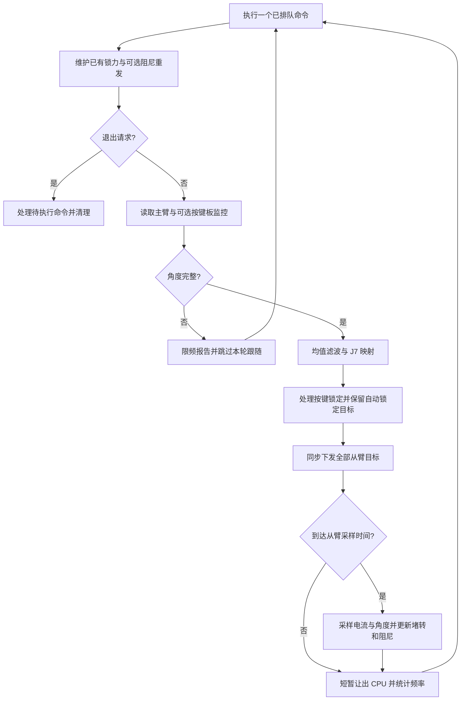
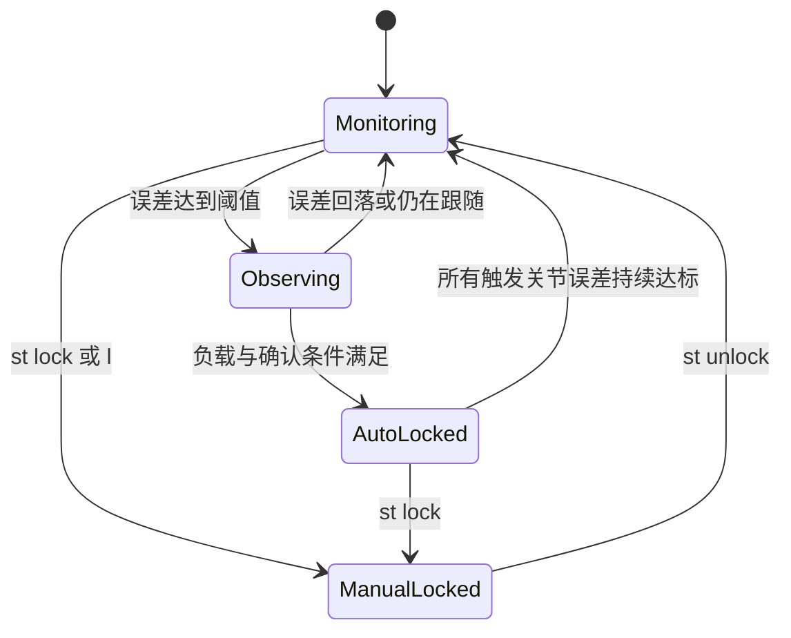

# 代码逻辑与控制流程

本页仅说明方案一：StarArm-102 主从臂的 `stararm102_ro.py`。B601-DM 与 Lumos 的逻辑分别见 [B601-DM 教程](b601_dm.md)、[Lumos 教程](lumos.md)。

## 结构

程序采用一个串口控制主线程和一个终端输入线程。输入线程读取文本，将其放入输入队列；主循环解析命令并处理控制状态，后续执行队列中的串口操作。控制操作优先于下一个输入，避免输入线程直接改动正在使用的锁定状态。

| 组件 | 职责 |
|---|---|
| `main` | 设备初始化、主循环、角度滤波、按键和退出清理 |
| `LoadFeedback` | 保存电流、参考值、阻尼映射和功率更新缓存 |
| `StallGuard` | 观察窗口、堵转判据、自动/手动锁定与解除条件 |
| `DampingConsole` | 命令队列、终端渲染、锁力下发、反馈采样调度 |
| `_read_monitors` | 清空上次监控字段，再调用 SDK 查询，识别缺失读数 |
| `_read_follower_monitors` | 合并多个从臂的电流与误差代表角度 |

## 主循环



默认滤波窗口为 1。J1–J6 取均值，J7 使用最新角度乘以 1.5，限制到 0–90°，不参与均值滤波。从臂位置帧采用 `<BlLHHH`，角度单位为 0.1°，间隔 100 ms，加减速时间各 50 ms，位置控制功率字段为 0。

控制频率没有固定保证。串口往返、SDK 超时、从臂数量和监控频率都会影响主循环；锁力维护在每轮采样之前执行，但仍处于同一个主线程，不能保证硬实时周期。

## 负载到阻尼的映射

每个关节单独计算：

```text
reference = max(current_floor + 1, configured_reference_or_peak)
ratio = clamp((abs(current) - current_floor) / (reference - current_floor), 0, 1)
power = round(power_min + ratio * (power_max - power_min))
```

默认噪声门槛 30 mA、功率范围 1–1200 mW、死区 20 mW、监控频率 30 Hz。只有目标功率变化达到死区或缓存为空时才重发。进入阻尼先发送停止后阻尼模式，再发送阻尼功率。

`fbmax auto` 使用 `max(current, previous_peak * exp(-dt / tau), floor)` 更新峰值，默认衰减时间常数 10 s。电流是负载代理量，不含机械传动与姿态补偿。

## 堵转判定

1. 误差 `abs(follower_angle - commanded_target)` 达到 `lock_deg`，建立观察窗口。
2. 窗口满 `track_win` 后，比较主从位移。
3. 主臂位移达到 `track_min_deg` 时，计算从臂沿主臂运动方向的位移比例。达到 `track_ratio` 视为仍在跟随；反向移动的比例为负数，不会按正常跟随处理。
4. 主臂基本不动时，如果误差至少缩小 `static_deg`，视为正在收敛；否则视为未跟随。`ststatic off` 关闭收敛豁免。
5. 未跟随且负载达到 `min_load_ratio`，累计一个确认窗口。达到 `confirm` 后加入堵转触发集合。
6. 根据 `lock_scope` 锁定全部关节或触发关节。`stalled` 模式下，后续新增堵转关节也会补充锁定。

默认负载条件基于去噪后的比例，而非简单的 `current / reference`。例如 floor=30 mA、reference=500 mA，30% 对应约 171 mA。

## 锁定和解除



图中省略了 `n`、`st off`、`st reset` 和手动阻尼等显式状态切换，详细行为见命令表。

锁定状态维护三组数据：被锁定的关节集合、主臂原始保持角度、最近下发时间。自动锁定还保存从臂触发时的目标角度，避免主臂被推动后从臂目标持续漂移。

默认 `both` 先下发停止后保持模式（`0x18` / `0x11`），再同步下发捕获角度的位置保持指令。重发沿用原始保持角度，不会重新采样为新的保持目标。若只选择位置保持而角度缺失，则回退为停止保持。

默认每 1 s 检查是否需要重发。重发由 `refresh` 执行，不依赖本轮从臂读取成功，也不依赖自动堵转功能是否开启。由于 SDK 读取会阻塞，实际重发间隔可能更长。

自动锁定：所有触发关节各自连续 0.3 s 满足误差 ≤ 8° 后解除。误差再次超限或监控缺失会清除解除计时。恢复状态按“电流反馈阻尼 → 原手动阻尼 → 卸力”的优先顺序选择。

手动锁定：不因跟随误差回落自动解除。HD 按键只释放由该按键建立的手动锁定，避免按键释放广播卸力覆盖控制台锁定。

## 通信数据有效性

所验证的 SDK 在查询未收到新回包时仍可能返回缓存对象。程序在查询前将 `angle_monitor`、`current` 清空，只有本轮更新的有限数值参与控制。这个处理依赖当前 SDK 的字段更新方式，升级后需要重新验证。

- 主臂任一必需角度缺失：本轮不发送新的从臂目标。
- 从臂读取失败：记录失败并至少退避 0.2 s，清除观察与自动解除计时；保留已建立的锁定。
- 多从臂：逐关节使用最大偏差角度、最大可用绝对电流；任一从臂该关节角度缺失时，丢弃该关节本轮合并结果。
- 缺少电流且负载门槛启用：不累积堵转确认，也不更新该关节阻尼。

通信缺失处理不会为从臂下发新的停止指令；从臂仍受其固件与上一条指令约束。

## 实现边界

这是软件反馈与保持控制，未实现末端力标定、硬实时调度、从臂急停、全关节软件限位或独立安全控制。正常循环退出会尝试主臂卸力并关闭已初始化串口；设备初始化期间抛出的异常不完全覆盖在该清理路径内。上机流程必须考虑设备本身的限位、保护阈值和停止方式。
