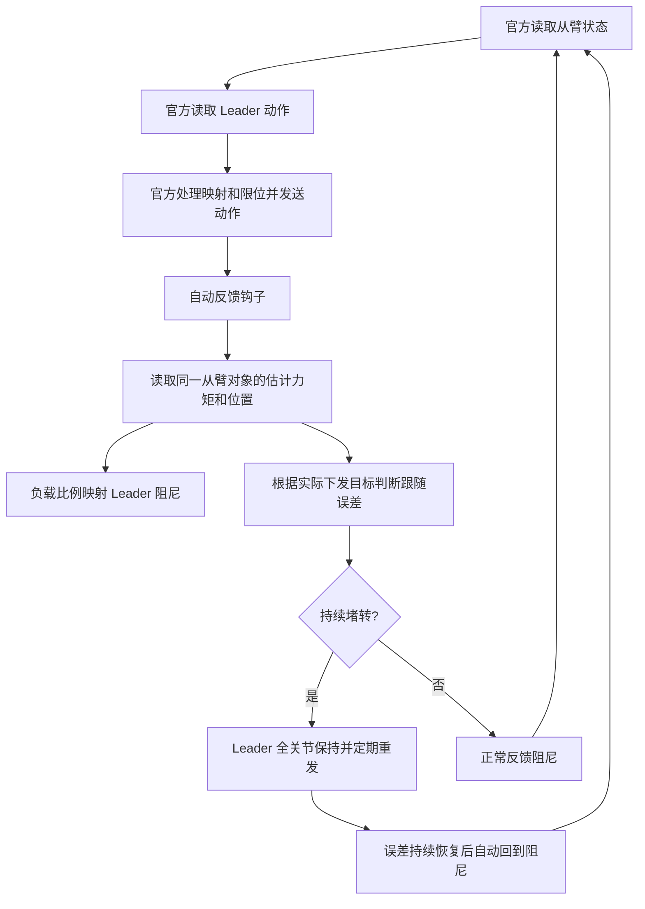

# 在官方 LeRobot 遥操作上增加自动反馈

本方案直接增强官方 `lerobot-teleoperate`：沿用已有的设备连接、标定、关节映射、控制模式、限位、相机和遥操作循环。增加的只有 **601 负载 → Leader 阻尼** 与 **堵转 → Leader 保持**。

没有新的遥操作启动脚本，没有手动输入 LD 扭矩或阻尼的控制台，不另开串口，不替换官方从臂驱动，也不改变传给从臂的动作。

此前独立运行的 `stararm102_b601_dm.py` 已移除，本页是 601 版本的使用方式。原 `stararm102_ro.py` 仅保留给 StarArm 自家从臂使用。

## 安装到你正在使用的环境

先进入能正常运行官方 LeRobot 遥操作命令的同一个 Python/Conda 环境，再进入本仓库：

```bash
git clone https://github.com/VincentHSS/stararm102-force-feedback.git
cd stararm102-force-feedback
python -m pip install ./integrations/lerobot_auto_feedback
python -m stararm_auto_feedback.install
```

已经下载仓库的用户先更新到最新版。插件没有新增驱动依赖，不要求重新安装 LeRobot 或重新标定主从臂。

安装程序定位当前环境的 `lerobot.scripts.lerobot_teleoperate`，先校验源代码结构，再备份并添加初始化、发送动作后的反馈处理和退出清理。重复安装不会重复插入；不认识的代码结构会报错并保持文件不变。

如果你的 LeRobot 是源码安装且自动定位失败，可明确指定官方文件：

```bash
python -m stararm_auto_feedback.install --script /path/to/lerobot/src/lerobot/scripts/lerobot_teleoperate.py
```

## 继续运行原来的官方命令

使用 Seeed 独立插件的示例：

```bash
lerobot-teleoperate \
  --robot.type=seeed_b601_dm_follower \
  --robot.port=/dev/ttyACM0 \
  --robot.id=follower1 \
  --robot.can_adapter=damiao \
  --teleop.type=rebot_arm_102_leader \
  --teleop.port=/dev/ttyUSB0 \
  --teleop.id=rebot_arm_102_leader
```

最新 LeRobot 内置设备的示例：

```bash
lerobot-teleoperate \
  --robot.type=rebot_b601_follower \
  --robot.motor_family=dm \
  --robot.port=/dev/ttyACM0 \
  --robot.id=follower \
  --teleop.type=rebot_102_leader \
  --teleop.port=/dev/ttyUSB0 \
  --teleop.id=leader
```

上面两组设备名称属于不同版本，不要混用。你已有可运行的命令就直接继续用它，端口、相机及其他原参数保持原样。插件仅针对上述 102 Leader + B601-DM 组合启用，对其他设备不生效。

正常运行不要求输入任何额外命令；插件只在启用、锁定、恢复和异常时记录日志，不增加实时扭矩表。官方原有的标定提示与终端状态显示保持不变。

## 自动工作流程



钩子使用官方 `robot.send_action()` 返回的实际动作，包含官方已经执行的目标限制。Seeed 外部插件返回电机角度，内置 LeRobot 返回公共坐标；插件分别处理这两种语义，再依据官方方向/比例配置换算为 Leader 等效角度。夹爪比例也取自官方配置，不新增另一套映射或零位。

本插件只改变 Leader 的阻尼/保持模式。官方从臂原来如何运行、发生错误时如何停止或清理，都由原代码处理；**Leader 保持不是从臂急停**。

## 默认自动参数

| 参数 | 默认 |
|---|---|
| 反馈处理频率上限 | 30 Hz |
| Leader 阻尼功率 | 1–1200 mW |
| 功率更新死区 | 20 mW |
| 观察误差阈值 | 20°，Leader 等效角度 |
| 观察窗口 | 0.4 s |
| 同向跟随比例 | 0.35 |
| 最低负载比例 | 0.3 |
| 连续确认窗口数 | 1 |
| 自动恢复误差 | ≤8°，持续 0.3 s |
| 保持功率 / 重发间隔 | 6000 mW / 1 s |

力矩反馈采用：

```text
load = clamp((abs(torque_nm) - floor_nm) / (reference_nm - floor_nm), 0, 1)
power_mw = round(power_min + load × (power_max - power_min))
```

默认参考力矩为前三关节 5 Nm、后四关节 1 Nm，噪声门槛分别为 0.1 Nm、0.05 Nm。这些是初始标尺，不是本机已完成的标定，也不是电机额定值。反馈包含重力和摩擦，不能直接当作末端接触力。

堵转判断同时使用误差、观察窗口、同向位移比例和负载条件。反向滑动不会被判为正常同向跟随。锁定后阻尼更新停止，避免覆盖保持模式；误差持续恢复后自动重新发送阻尼设置。

Leader 控制复用已连接的 `FashionStarServo.set_stop_mode()`：`0x12` 设置阻尼、`0x11` 保持。未调用独立 UART 驱动或未验证的角度写接口。具体阻尼和保持能力仍需结合本机固件上机验证。

## 可选：修改自动参数

通常先使用默认值观察。需要调整时，复制并修改：

```text
integrations/lerobot_auto_feedback/feedback.example.json
```

设置文件路径后，仍然运行原官方命令。Linux：

```bash
export STARARM_FEEDBACK_CONFIG="/path/to/feedback.json"
```

PowerShell：

```powershell
$env:STARARM_FEEDBACK_CONFIG="C:\path\feedback.json"
```

文件可以只包含要修改的顶层字段；`torque_reference_nm`、`torque_floor_nm` 若提供，则需填写完整七关节字典。`enabled=false` 可暂时关闭插件逻辑。修改后重启遥操作生效，无需运行时输入扭矩值。

## 数据有效性与边界

插件在现有 Leader 监控调用中检查 `ServoMonitor.reliable`，不会把已标记不可靠的 Leader 缓存当作正常读数。缺失从臂状态、非使能状态、非有限数值或读取异常时，会请求 Leader 保持，并中断堵转确认和解除计时；数据恢复且误差持续回落后恢复。

官方 MotorBridge `get_state()` 是缓存接口，目前提供的状态没有逐帧时间戳/序号。此集成保留官方读取路径，**无法独立确认每一份非空从臂缓存都来自本轮新回包**。它不替代官方通信保护，更不能保证断线时仍能送达保持指令。保持重发也受官方主循环和 SDK 阻塞时间影响。

正常退出时，插件释放自己设置过的 Leader 关节并还原监控方法，再交由官方原有流程清理从臂。不要同时运行另一份控制同一串口的程序。

## 卸载或升级 LeRobot

先在同一环境恢复官方文件：

```bash
python -m stararm_auto_feedback.install --remove
python -m pip uninstall stararm-lerobot-auto-feedback
```

恢复时会检查备份和当前文件的哈希；如果安装后你修改了官方文件，程序会拒绝覆盖。先保留你的改动，再处理备份。升级 LeRobot 前建议恢复，升级后重新安装钩子；不支持的结构会明确报错。

当前只挂接 `lerobot-teleoperate`，没有给 `lerobot-record` 或 SenseCraft 图形软件注入代码。

## 开发与验证

```bash
python -m unittest discover -s tests -v
```

新增 28 项集成测试覆盖自动阻尼、方向/夹爪比例、锁定与持续恢复、读数异常、生命周期清理、原动作不变，以及安装备份、重复安装与还原。加上原有 StarArm 控制器的 24 项，共 52 项。安装钩子还对当前官方主循环做了编译和 AST 对比，确认移除新增钩子后原循环结构不变。

以上是无硬件验证，未安装并运行完整 LeRobot 控制真实机械臂，未验证本机固件的实际阻尼和锁力。

接口来源：

- [Seeed 官方 102 Leader 插件](https://github.com/Seeed-Projects/lerobot-teleoperator-rebot-arm-102)
- [Seeed 官方 B601 从臂插件](https://github.com/Seeed-Projects/lerobot-robot-seeed-b601)
- [LeRobot 官方遥操作循环](https://github.com/huggingface/lerobot/blob/main/src/lerobot/scripts/lerobot_teleoperate.py)
- [LeRobot 内置 102 Leader](https://github.com/huggingface/lerobot/tree/main/src/lerobot/teleoperators/rebot_102_leader)
- [LeRobot 内置 B601 从臂](https://github.com/huggingface/lerobot/tree/main/src/lerobot/robots/rebot_b601_follower)
